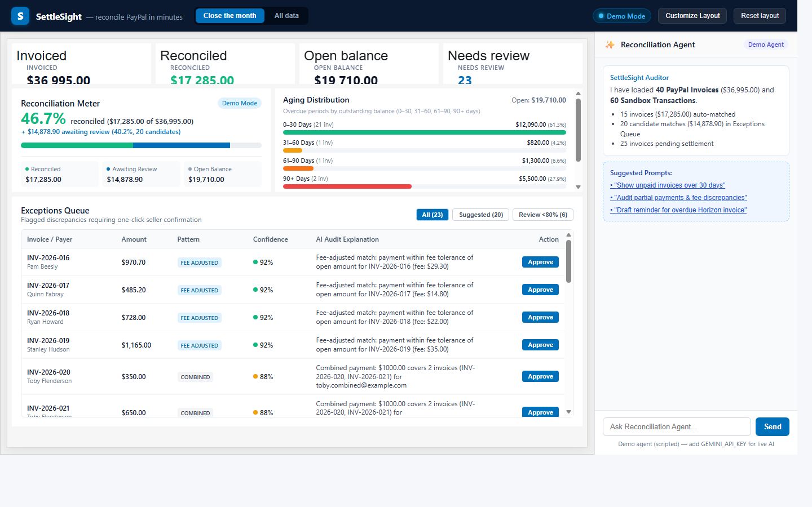

# SettleSight — AI Reconciliation Desk for PayPal Sellers

> **One-Line Pitch:** SettleSight reconciles PayPal invoices against PayPal transactions in minutes using deterministic math verification, an AG Studio analytics dashboard, and an AI auditor that explains discrepancies before you approve write-backs.

### 🚀 Try It in 10 Seconds (No Keys Required)
👉 **[Launch SettleSight Live Demo](https://ryandev1st.github.io/settlesight/)**



Runs 100% in your browser on GitHub Pages with pre-seeded sandbox snapshot data and a scripted AI runner. No PayPal credentials, API tokens, or server installations required to evaluate.

---

## The Problem: Month-End Reconciliation Chaos

Small businesses, digital agencies, and independent freelancers collecting payments via PayPal face recurring friction when closing their monthly books:

1. **Hidden Transaction Fees:** A customer pays a $1,000 invoice, but PayPal deposits $965.10 after processing fees. Standard accounting systems flag a $34.90 discrepancy unless fees are explicitly calculated and booked.
2. **Partial Payments & Milestone Installments:** Clients pay retainers or installments (e.g., $600 against a $1,200 invoice) without specifying how the balance should be allocated.
3. **Combined Payments:** A single corporate wire or transfer of $2,500 covers multiple distinct invoices (e.g., Invoice #014 for $1,000 and Invoice #015 for $1,500) from the same payer.
4. **Missing Invoice References:** Buyers frequently remit funds via PayPal balance or direct email transfer without entering the invoice number in the memo field.
5. **Refunds & Courtesy Credits:** Chargebacks and refund debits (event code `T1107`) break clean ledger balances.
6. **Duplicate Payments:** Accidental double submissions cause over-allocations and messy ledger errors.

Sellers spend hours comparing PayPal CSV activity exports against open invoices manually.

---

## How It Works: Engine → AI Agent → Human Approval → Write-Back

SettleSight enforces strict separation between deterministic financial verification, AI assistance, and ledger mutations:

```
 ┌──────────────────────┐         ┌────────────────────────┐
 │ PayPal Invoicing v2  │         │ Transaction Search v1  │
 └──────────┬───────────┘         └───────────┬────────────┘
            │                                 │
            ▼                                 ▼
   ┌──────────────────────────────────────────────────┐
   │    Deterministic Match Engine (src/match/)       │
   │  - Integer-cent math (zero rounding drift)       │
   │  - Exact matches auto-reconciled (conf 1.0)      │
   │  - Heuristic candidate generation (fee/partial)  │
   └────────────────────────┬─────────────────────────┘
                            │
                            ▼
   ┌──────────────────────────────────────────────────┐
   │       AI Reconciliation Agent (src/agent/)       │
   │  - Studio Agent Framework integration            │
   │  - Explains fee breakdowns & audit reasoning     │
   │  - Drafts overdue reminder emails                │
   └────────────────────────┬─────────────────────────┘
                            │
                            ▼
   ┌──────────────────────────────────────────────────┐
   │   Invariant Math Validator (src/match/validator) │
   │  - Rejects over-allocations & currency mismatch  │
   │  - Prohibits AI from mutating balances           │
   └────────────────────────┬─────────────────────────┘
                            │
                            ▼
   ┌──────────────────────────────────────────────────┐
   │    Human In The Loop (AG Studio UI / Shell)      │
   │  - One-click Seller Confirmation (No auto-write) │
   └────────────────────────┬─────────────────────────┘
                            │
                            ▼
   ┌──────────────────────────────────────────────────┐
   │      PayPal Write-Back Proxy (server/paypal.mjs) │
   │  - POST /v2/invoicing/invoices/{id}/payments     │
   │  - POST /v2/invoicing/invoices/{id}/remind       │
   └──────────────────────────────────────────────────┘
```

1. **Ingest & Normalize:** PayPal Invoicing v2 records and Transaction Search feeds are normalized into integer cents (`src/match/normalize.js`).
2. **Deterministic Matching:** Auto-matches clean transactions (exact invoice reference and equal gross amount) with confidence 1.0 (rule-based). Harder cases (fees, combined, partial, email match, refunds, duplicates) generate scored candidates (`src/match/rules.js`).
3. **AI Explanations & Audit:** The Reconciliation Agent reviews ambiguous exceptions, calculates fee deductions against standard merchant tiers (~2.9% + $0.30), and drafts payment reminder emails (`src/agent/agent-definition.ts`).
4. **Invariant Validation:** Every candidate match passes mathematical validation (`validateAllocation` in `src/match/validator.js`) ensuring non-over-allocation, currency alignment, and capacity checks.
5. **Human Approval & Write-Back:** The seller reviews suggestions in the **Exceptions Queue** widget and confirms write-backs with an explicit click. The backend records payments on PayPal or dispatches reminders.

---

## PayPal APIs Used & Code References

All PayPal REST API calls are isolated in `server/paypal.mjs` and orchestrated through the local proxy `server/index.mjs`:

| PayPal API & Endpoint | Method | Implementation File & Function | Purpose & Hackathon Usage |
| :--- | :---: | :--- | :--- |
| **OAuth 2.0 Client Credentials**<br>`/v1/oauth2/token` | `POST` | [`server/paypal.mjs`](server/paypal.mjs)<br>`PayPalClient.prototype.getAccessToken` | Generates short-lived bearer tokens using `PAYPAL_CLIENT_ID` and `PAYPAL_CLIENT_SECRET` with in-memory expiration caching. |
| **Invoicing v2: List Invoices**<br>`/v2/invoicing/invoices` | `GET` | [`server/paypal.mjs`](server/paypal.mjs)<br>`PayPalClient.prototype.listInvoices` | Fetches open, paid, and overdue merchant invoices with automatic pagination traversal. |
| **Invoicing v2: Record Payment**<br>`/v2/invoicing/invoices/{id}/payments` | `POST` | [`server/paypal.mjs`](server/paypal.mjs)<br>`PayPalClient.prototype.recordPayment` | Records verified payments against PayPal invoices once approved by the user. Protected by `confirmedByUser: true`. |
| **Invoicing v2: Send Reminder**<br>`/v2/invoicing/invoices/{id}/remind` | `POST` | [`server/paypal.mjs`](server/paypal.mjs)<br>`PayPalClient.prototype.sendReminder` | Dispatches polite reminder notifications for overdue invoices directly through PayPal. Protected by `confirmedByUser: true`. |
| **Transaction Search v1**<br>`/v1/reporting/transactions` | `GET` | [`server/paypal.mjs`](server/paypal.mjs)<br>`PayPalClient.prototype.listTransactions`<br>`splitDateRangeIntoWindows` | Queries settled transactions across rolling date windows. Automatically splits ranges into $\le 31$-day chunks to satisfy PayPal API constraints. |
| **Sandbox Seeder**<br>`/v2/invoicing/invoices` | `POST` | [`scripts/seed-sandbox.mjs`](scripts/seed-sandbox.mjs)<br>`run`, `SEED_SPECIFICATION` | Seeds a realistic 30-invoice, 8-scenario dataset into the seller's sandbox environment covering every reconciliation edge case. |

> ⚠️ **PayPal Sandbox Latency Note:** PayPal Transaction Search v1 reporting feeds enforce a maximum 31-day search window per request. In addition, newly recorded transactions in the PayPal sandbox environment may take up to **3 hours** to propagate into Transaction Search query results. SettleSight includes both pre-seeded demo fixtures (`src/data/demo/`) and full date-window chunking (`splitDateRangeIntoWindows`) to handle this behavior cleanly.

---

## AI Implementation: Studio Agent Framework & Gemini Proxy

SettleSight integrates AI at multiple architectural layers:

### 1. Studio Agent Framework Integration
In [`src/agent/agent-definition.ts`](src/agent/agent-definition.ts), SettleSight implements AG Studio's official AI APIs (`createAiHarness`, `directLlmRunner` from `ag-studio`):
- **Agent Identity:** The **Reconciliation Auditor** (`reconciliation-auditor`) provides autonomous merchant auditing.
- **Dynamic Context Injection:** Ledger metrics (total open invoices, unallocated transactions, suggested matches) are injected dynamically into the agent prompt.
- **Guarded Tool Schemas:**
  - `list_exceptions`: Queries candidate matches filtered by confidence or overdue thresholds.
  - `explain_match`: Audits fee calculations and explains why a candidate was proposed.
  - `draft_reminder`: Drafts professional reminder emails for overdue accounts without auto-sending.

### 2. Gemini LLM Adapter via Server Proxy
- **Client Adapter:** [`src/agent/llm-adapter.ts`](src/agent/llm-adapter.ts) (`GeminiLlmAdapter`) implements AG Studio's `AgAiLlmAdapter` interface.
- **Secure Server Proxy:** [`server/llm.mjs`](server/llm.mjs) (`LlmClient`) proxies completions to Google's OpenAI-compatible endpoint (`gemini-2.5-flash`) at `https://generativelanguage.googleapis.com/v1beta/openai/chat/completions`.
- **Credential Protection:** The `GEMINI_API_KEY` remains strictly server-side inside `.env`; the browser client never receives or exposes API keys.

### 3. Scripted Demo Runner (Zero-Key Evaluation)
- [`src/agent/scripted-runner.js`](src/agent/scripted-runner.js) (`runScriptedDemo`) enables complete evaluation in demo mode.
- Executes real deterministic tool calls (`listExceptions`, `explainMatch`, `draftReminder` from `src/agent/tools.js`) and renders visible tool execution badges (`🔧 Tool Call: list_exceptions()`) inside the chat panel.
- Clearly displays the labelled notice: `Demo agent (scripted) — add GEMINI_API_KEY for live AI`.

---

## Nebius Token Factory & NVIDIA Nemotron Integration

SettleSight includes first-class support for **Nebius Token Factory** and **NVIDIA Nemotron** open models for autonomous financial agent reasoning and exception triage:

### 1. Nebius Token Factory Architecture
- **OpenAI-Compatible Endpoint:** Requests are proxied server-side to `https://api.tokenfactory.nebius.com/v1/chat/completions` ([Nebius Token Factory Documentation](https://docs.tokenfactory.nebius.com/quickstart)).
- **Authorization:** Standard Bearer token authentication via `Authorization: Bearer <NEBIUS_API_KEY>`. API keys remain strictly server-side inside `.env`; the browser never handles credentials.
- **Provider Selection:** Selected via `LLM_PROVIDER=nebius` (default) or `LLM_PROVIDER=gemini` in `.env`.
- **Supported Nemotron Models:**
  - Runtime discovery uses cached `GET /v1/models`; `NEBIUS_MODEL` overrides automatic selection and must exist in the catalog.
  - `nvidia/nemotron-3-super-120b-a12b`: Preferred for triage; also verified with real tool calling.
  - `nvidia/NVIDIA-Nemotron-3-Nano-30B-A3B` or `nvidia/Nemotron-3_5-Lightning`: Preferred for fast tool calls.
  - `nvidia/Nemotron-3-Ultra-550b-a55b`: Discovered alternative; not live-tested here.
  - If no NVIDIA Nemotron model is available, discovery fails explicitly.

### Verified live on 2026-10-11

Real Nemotron triage and tool calling, 30 PayPal sandbox invoices, Transaction Search, and one confirmed payment write-back were verified locally. Recorded payments remain a baseline on reload, without double-counting matching transactions. The dashboard labels its demo transaction fallback if Transaction Search is denied. See [live verification results](docs/live-verification.md) for timings, token usage, evidence, and limitations.

### 2. LLM-Ranked Exception Triage Mode
In [`src/agent/triage.js`](src/agent/triage.js), SettleSight introduces **LLM-Ranked Exception Triage**:
- **Nemotron Reasoning:** Nemotron Super/Ultra evaluates the match engine's candidate pool, audits fee adjustments against PayPal's standard tiers (~2.9% + $0.30), detects partial milestone payments, and outputs a prioritized review queue with risk assessments.
- **Deterministic Math Authority:** Every proposed allocation passes through `validateAllocation` in [`src/match/validator.js`](src/match/validator.js).
- **Invariant Rejection Handling:** If the LLM proposes an allocation exceeding the invoice balance, allocating more than transaction gross, or mixing currencies, the deterministic engine flags it as `❌ Invariant Rejection` with the exact mathematical error. AI advises; the deterministic engine governs.

### 3. Real Function Calling Loop
In [`src/agent/nemotron-runner.js`](src/agent/nemotron-runner.js), the agent executes real OpenAI-compatible function calling with Nemotron:
- Registers four client-side tools: `list_exceptions`, `explain_match`, `draft_reminder`, and `triage_exceptions`.
- Traverses a two-turn loop: Nemotron emits structured `tool_calls`, the agent executes deterministic operations on the ledger state, and returns tool outputs for final assistant synthesis.
- Gracefully falls back to the deterministic scripted runner when `NEBIUS_API_KEY` is not configured.

### 4. Interactive UI Controls
- **"AI triage (Nemotron)" Toggle:** Added to [`src/ui/agent-chat-panel.tsx`](src/ui/agent-chat-panel.tsx), visible only when the backend health check reports `llmProvider: "nebius"`.
- Displays real-time triage status, priority rankings (`Critical`, `High`, `Medium`), Nemotron explanations, and one-click seller approval for validated allocations.

---

## AG Studio Usage: Polish, Theming & Custom Analytics

SettleSight showcases the capabilities of **AG Studio 3.0** (`ag-studio`, `ag-studio-react`):

1. **Custom Analytics Widgets** ([`src/studio/widgets/`](src/studio/widgets/)):
   - **Reconciliation Meter** ([`reconciliation-meter.tsx`](src/studio/widgets/reconciliation-meter.tsx)): Real-time horizontal progress indicator displaying percentage of reconciled revenue versus open receivables.
   - **Aging Distribution Chart** ([`aging-chart.tsx`](src/studio/widgets/aging-chart.tsx)): Interactive bar chart segmenting open invoice balances across aging buckets (`0-30`, `31-60`, `61-90`, `90+` days).
   - **Exceptions Queue** ([`exceptions-queue.tsx`](src/studio/widgets/exceptions-queue.tsx)): Interactive triage grid showing candidate matches, confidence percentages, rule explanations, and one-click **Approve** and **Reject** buttons.
2. **PayPal Brand Theme** ([`src/studio/theme.ts`](src/studio/theme.ts)):
   - Custom `paypalTheme` created using `studioTheme.withParams` with PayPal brand colors (`#0070BA` accent, clean light and dark palette tokens).
3. **Saved Layout Persistence** ([`src/studio/state.ts`](src/studio/state.ts)):
   - Dashboard layouts, open tabs, and custom widget placements persist automatically to browser `localStorage` (`settlesight_studio_layout_v4`) with full "Customize Layout" and "Reset layout" controls in the top shell.
4. **Studio Agent Framework Integration**:
   - The Reconciliation Auditor agent runs directly inside the AG Studio agent architecture alongside Studio's built-in agents.

---

## Running Live Locally

### Prerequisites
- Node.js 22+
- npm 10+
- (Optional) PayPal Developer Sandbox REST app credentials from [developer.paypal.com](https://developer.paypal.com/dashboard/applications/sandbox)
- (Optional) Free Google AI Studio API key from [aistudio.google.com](https://aistudio.google.com/)

### Step-by-Step Setup

```bash
# 1. Clone the repository and install dependencies
git clone https://github.com/ryandev1st/settlesight.git
cd settlesight
npm install

# 2. Configure environment variables
cp env.example .env
```

Edit `.env` with your sandbox and AI keys:
```env
PAYPAL_CLIENT_ID=your_sandbox_client_id
PAYPAL_CLIENT_SECRET=your_sandbox_client_secret
GEMINI_API_KEY=your_gemini_api_key  # Optional: enables live Gemini LLM
PORT=8787
```

```bash
# 3. Seed your PayPal Sandbox with realistic test invoices (Optional)
npm run seed

# 4. Start the local PayPal & LLM proxy server
npm run dev:server

# 5. In a second terminal, start the Vite frontend
npm run dev
```

Open your browser at `http://localhost:5173`. SettleSight will automatically detect your configured backend proxy and switch from **Demo Mode** to **Live Sandbox Mode**.

---

## Automated Test Suite

SettleSight includes a comprehensive, zero-external-runner test suite built using Node.js's native test runner (`node --test`):

```bash
npm test
```

The suite validates 57 individual test cases across 3 suites:
- **Match Engine & Rules:** Verifies all 7 reconciliation heuristics (`exact`, `fee_adjusted`, `combined`, `partial`, `email`, `refund`, `duplicate`).
- **Mathematical Invariant Validation:** Rejects over-allocations, currency mismatches, and negative amounts.
- **Agent Tools & Scripted Runner:** Validates exception extraction, match explanations, reminder email generation, and tool step schemas.
- **PayPal Client & Server:** Validates OAuth caching, 31-day search window chunking, and confirmation guards.
- **Regression Suite:** Integer-cent arithmetic avoids floating-point drift; covered by regression tests and preserves single-source-of-truth state transitions.

---

## Built During the Hackathon (Disclosures per Rules §4)

In accordance with Section 4 of the official PayPal AI Hackathon rules regarding pre-existing work disclosures:

### Pre-Existing Work (Prior to October 1, 2026)
- **Origin:** An offline browser utility prototype (`products/invoice-match-desk/core.js`, 124 lines) created prior to October 1, 2026.
- **Pre-Existing Scope:** Contained basic offline CSV spreadsheet parsing and elementary exact-match string comparisons for static files. It contained no PayPal integrations, no AI agents, no AG Studio widgets, and no live API capabilities.

### Built Newly During the Hackathon Submission Period
All code in the `settlesight` repository was newly architected and written during the hackathon period:
- **Git Commit Evidence:**
  - `451750d Fri Oct 9 15:18:03 2026`: Initial scaffold of SettleSight AG Studio dashboard, themes, and shell.
  - `d894aae Fri Oct 9 15:27:40 2026`: PayPal sandbox proxy (`server/paypal.mjs`), live data loading, and 30-invoice seeder (`scripts/seed-sandbox.mjs`).
  - `87dc739 Fri Oct 9 15:50:41 2026`: AG Studio Agent Framework harness (`src/agent/`), Gemini LLM proxy (`server/llm.mjs`), custom tools, and scripted demo runner.
  - `9169af6 Sat Oct 10 22:12:01 2026`: Deterministic match engine (`src/match/`), mathematical invariant validator, and 57-test regression suite.
- **Newly Built Features:**
  1. Complete PayPal REST integration: OAuth 2.0 credentials caching, Invoicing v2 (list, record payment, remind), and Transaction Search v1 with 31-day window chunking.
  2. AG Studio 3.0 embedded analytics dashboard with custom `paypalTheme` and 3 custom analytics widgets (`ReconciliationMeter`, `AgingChart`, `ExceptionsQueue`).
  3. AG Studio Agent Framework integration with custom Reconciliation Auditor agent, tool definitions, Gemini OpenAI adapter, and guarded execution.
  4. Mathematical invariant validator enforcing integer-cent arithmetic and strict human-in-the-loop write-back safety.
  5. Scripted demo runner and GitHub Pages static build allowing zero-install evaluation.

---

## Limitations & Honest Notes

- **Synthetic Demo Data:** The default demo mode runs on pre-seeded snapshot data (`src/data/demo/`) representing real PayPal sandbox payloads. It does not access production bank accounts or real customer funds.
- **AG Studio Evaluation License:** Uses the official 45-day trial license provided by AG Grid for hackathon participants. In demo mode, a small trial watermark is standard for AG Studio evaluation builds.
- **Scripted Demo Agent Labeling:** In demo mode (or when `GEMINI_API_KEY` is omitted), the chat assistant runs the scripted demo engine and is transparently labelled as `Demo agent (scripted) — add GEMINI_API_KEY for live AI`.
- **Write-Back Human Confirmation:** SettleSight deliberately does not perform autonomous payment write-backs without seller confirmation. Every write-back requires a human click in the Exceptions Queue or audit modal.

---

## License

This project is licensed under the [MIT License](LICENSE) — see the LICENSE file for details.
Copyright © 2026 SettleSight contributors.
