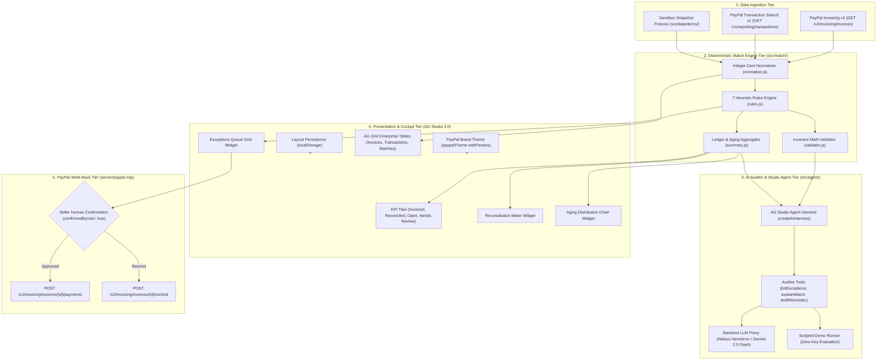

# SettleSight Architecture & Data Flow

This document details the internal design, component relationships, and data flow of **SettleSight**.

---

## 1. High-Level Architecture

SettleSight operates on a four-tier architecture designed to enforce strict separation between data ingestion, deterministic mathematical matching, AI auditing, and ledger mutations:

---

## 2. Integer-Cent Financial Arithmetic

To eliminate floating-point representation drift (e.g., `0.1 + 0.2 !== 0.3`), all monetary values are represented internally as positive integer cents:

- `$1,250.00` is stored as `125000`
- `$17.30` is stored as `1730`

Conversion occurs strictly at boundaries:
- `toCents(decimal)` in [`src/match/normalize.js`](../src/match/normalize.js) parses strings or floats on ingest.
- `fromCents(cents)` in [`src/match/normalize.js`](../src/match/normalize.js) converts cents back to decimal dollars for display in AG Studio sources and UI components.

---

## 3. Matching Rules and Scoring Hierarchy

The deterministic match engine evaluates transactions against open invoices in a strict priority order:

| Rule Method | Score / Confidence | Default State | Description |
| :--- | :---: | :---: | :--- |
| `exact` | `1.00` | `auto` | Exact match on invoice reference code and identical gross deposit. Auto-applied without human triage. |
| `fee_adjusted` | `0.92` | `suggested` | Gross transaction matches invoice total, but net deposit reflects PayPal standard merchant processing fees (~2.9% + $0.30). |
| `combined` | `0.88` | `suggested` | Single lump-sum payment covers multiple open invoices from the same payer email address. |
| `partial` | `0.80` | `suggested` | Transaction reference matches invoice, but amount covers only a partial installment. |
| `email` | `0.75` | `suggested` | Payer email matches invoice recipient email with equal amount, but reference code was omitted from payment memo. |
| `refund` | `0.85` | `suggested` | Debit transaction with event code `T1107` linked to an original settled invoice. |
| `duplicate` | `0.70` | `suggested` | Second transaction referencing an invoice that is already fully paid. |

### Ambiguity Handling
When multiple open invoices or transactions compete for the same candidate with equal confidence, the engine does not guess. The item is classified as an **ambiguity exception** and routed to the Exceptions Queue for manual human resolution.

---

## 4. Invariant Validation Rules

Before any allocation is approved or written to state, [`validateAllocation()`](../src/match/validator.js) enforces six mathematical invariants:

1. **Existence:** Both the invoice and transaction IDs must resolve to active ledger records.
2. **Currency Uniformity:** Currency codes must be identical (e.g., USD to USD).
3. **Integer Positivity:** Allocated cents must be a positive safe integer ($> 0$).
4. **Capacity Isolation:** Only matches in state `auto` or `approved` consume invoice capacity. Pending `suggested` candidates do not reduce open capacity.
5. **No Invoice Over-Allocation:** Sum of committed allocations cannot exceed the original invoice total.
6. **No Transaction Over-Allocation:** Sum of committed allocations cannot exceed the transaction gross.

---

## 5. Security & Credential Isolation

- Secrets (`PAYPAL_CLIENT_ID`, `PAYPAL_CLIENT_SECRET`, `GEMINI_API_KEY`) are kept exclusively on the local Node.js proxy server (`server/index.mjs`).
- The browser frontend connects to the proxy via relative `/api` paths handled by Vite dev server proxying.
- The browser client never receives, logs, or stores API credentials.
- All write-back mutations (`recordPayment`, `sendReminder`) require explicit `confirmedByUser: true` payload validation from the server before executing any external PayPal API call.
